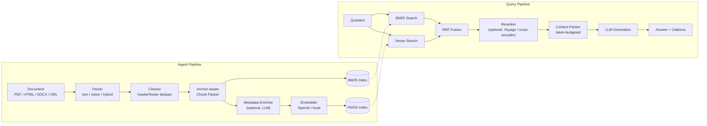

# RAG Framework

A modular, pluggable Retrieval-Augmented Generation (RAG) framework with hybrid search, full pipeline observability, and a Streamlit developer studio.

> **Not sure what RAG is?** RAG (Retrieval-Augmented Generation) lets you ask questions about your own documents. You upload files (PDFs, Word docs, web pages), and the system finds the most relevant passages and uses an LLM to write a grounded answer with citations.

---

## Why this project exists

Most RAG tutorials wire together a vector store and an LLM call and stop there.
This project is an attempt to build the parts that tutorials skip, and to
measure whether they actually work rather than assume it:

- **Every stage is swappable behind an interface** — parser, embedder,
  vector index, keyword index, reranker, LLM client — so a chunking or
  reranking change is a config change, not a rewrite (see
  [Architecture](#architecture) below).
- **Every retrieval claim is backed by a real evaluation, not intuition.**
  Chunk size, hybrid retrieval, reranking, and LLM metadata enrichment were
  each tested with a human-labeled QA dataset and reported honestly —
  including the one that turned out to be a **null result**. See
  [Results at a glance](#results-at-a-glance) and the full write-up in
  [EVAL_RESULTS.md](EVAL_RESULTS.md).
- **Production concerns are treated as first-class**, not afterthoughts:
  cross-process file locking so concurrent ingests can't silently lose data,
  MCP stdio hardened against protocol corruption, per-document cost/timing
  tracking, and a batch-ingest path with a proven O(1)-in-`max_workers`
  memory bound rather than one that merely looks bounded.

This is a solo, from-scratch build (no RAG framework/template as a starting
point) used as a vehicle to learn production ML-systems engineering —
chunking strategy, hybrid retrieval, evaluation methodology, and the
unglamorous reliability work (concurrency, memory, protocol safety) that
tutorials rarely cover. See [Known limitations](#known-limitations) for what
it deliberately does not claim.

---

## Architecture



Every box on both sides is a swap-in behind a `Base*` interface in
`rag/core/interfaces/` — e.g. adding a new reranker means implementing
`BaseReranker.rerank()`, not touching the pipeline that calls it. The same
`IngestPipeline`/`QueryPipeline` code path is shared by the CLI, the
Streamlit Studio, and the MCP server (see [Project Structure](#11-project-structure)).

Two design choices worth calling out:
- **RRF (Reciprocal Rank Fusion)**, not a learned or weighted blend, combines
  BM25 and vector rankings — no tuning knob to overfit to one eval set.
- **Reranking is query-time-only.** It never touches what's ingested, which
  is why the reranker experiment below could reuse an already-built index
  instead of re-ingesting (see `scripts/asqa_eval.py`).

---

## Results at a glance

Built on [ASQA](https://huggingface.co/datasets/din0s/asqa), a human-labeled
QA dataset, with a from-scratch corpus/eval harness (`scripts/asqa_eval.py`)
since ASQA ships questions but not pre-chunked passages. Full methodology,
caveats, and reproduction commands are in **[EVAL_RESULTS.md](EVAL_RESULTS.md)**.

| Question tested | Finding |
|---|---|
| What chunk size? | **512 tokens** is the sweet spot — recall climbs sharply 128→512, then flattens (+0.6pt 512→768) |
| Does hybrid (BM25+embedding) retrieval help? | **Yes: +6.6pt recall@5** over BM25-only, at 12x query latency |
| Does a reranker help? | **Yes: +9.2pt recall@5** over BM25-only (VoyageReranker), at 8.5x latency — no ingestion changes needed |
| Does LLM metadata enrichment help? | **No — a null result.** +0.0pt recall@5 despite real API cost. Reported honestly rather than omitted. |
| Ingest throughput bottlenecks? | Vision-LLM transcription and embedding calls were both sequential where they should have been parallel — fixed (8.0x simulated / **3.5x live-measured** speedups); batch-mode BM25 rebuild was **O(N²)** — fixed to O(N) (3.2x measured) |

A real production bug was also found and fixed *during* this evaluation work —
not by a unit test, but by the eval returning 0% recall and forcing a root
cause — see [Bug found during this study](EVAL_RESULTS.md#bug-found-during-this-study)
in the full write-up.

---

## Table of Contents

1. [What You'll Need](#1-what-youll-need)
2. [Installation](#2-installation)
3. [Configuration](#3-configuration)
4. [Your First Run — Streamlit Studio](#4-your-first-run--streamlit-studio)
5. [Step-by-Step: Ingest → Query → Evaluate](#5-step-by-step-ingest--query--evaluate)
6. [CLI Usage](#6-cli-usage)
7. [Docker](#7-docker)
8. [MCP Server (Claude Integration)](#8-mcp-server-claude-integration)
9. [External Connectors](#9-external-connectors)
10. [Evaluation Results](#10-evaluation-results)
11. [Project Structure](#11-project-structure)
12. [Running Tests](#12-running-tests)
13. [Troubleshooting](#13-troubleshooting)
14. [Known Limitations](#known-limitations)

---

## 1. What You'll Need

| Requirement | Version | Notes |
|-------------|---------|-------|
| Python | 3.11 or 3.12 | [Download](https://www.python.org/downloads/) |
| OpenAI API key | — | [Get one here](https://platform.openai.com/api-keys) — used for embeddings and answer generation |
| Git | Any | To clone this repo |
| Docker (optional) | 24+ | Only needed for the Docker setup path |

You do **not** need a GPU. Everything runs on CPU.

---

## 2. Installation

### Option A — Local (recommended for development)

```bash
# 1. Clone the repo
git clone <repo-url>
cd rag-framework

# 2. Create a virtual environment
python -m venv .venv

# 3. Activate it
#    On macOS / Linux:
source .venv/bin/activate
#    On Windows:
.venv\Scripts\activate

# 4. Install the framework
pip install -e ".[dev]"

# 5. Install optional extras (needed for RAGAS answer quality evaluation)
pip install ragas langchain langchain-openai

# 6. Install optional document parsers (Word / Excel support)
pip install python-docx openpyxl
```

### Option B — Docker

See [Section 7 — Docker](#7-docker).

---

## 3. Configuration

### 3.1 Create your `.env` file

```bash
cp .env.example .env
```

Open `.env` and fill in your values:

```dotenv
# Required
OPENAI_API_KEY=sk-...          # Your OpenAI API key

# Optional — only needed if you use Voyage reranking
VOYAGE_API_KEY=pa-...

# Optional — storage location (defaults to ./data)
RAG_DATA_DIR=./data
```

> ⚠️ Never commit your `.env` file. It is already in `.gitignore`.

### 3.2 Settings overview

All pipeline settings live in `configs/settings.yaml`. You can edit them directly or create a profile override. The main settings you might want to change:

| Setting | Default | What it controls |
|---------|---------|-----------------|
| `embedding.provider` | `openai` | Which embedding model to use (`openai` or `multilingual`) |
| `retrieval.bm25_top_k` | `20` | How many BM25 candidates to retrieve |
| `generation.llm_model` | `gpt-4o-mini` | Which OpenAI model generates answers |
| `ingestion.chunk_max_tokens` | `400` | Max tokens per chunk |
| `reranking.enabled` | `true` | Whether to rerank results |

---

## 4. Your First Run — Streamlit Studio

The easiest way to use the framework is through the browser UI:

```bash
# Make sure your .env is set up, then:
streamlit run rag/app/studio/studio.py
```

Open **http://localhost:8501** in your browser. You'll see 4 pages in the sidebar:

| Page | What it does |
|------|-------------|
| **Ingest & Inspect** | Upload documents and browse the chunks created from them |
| **Query Traces** | Ask questions and see the full retrieval pipeline step-by-step |
| **Evaluation Panel** | Run retrieval quality benchmarks and RAGAS answer quality scoring |
| **Connector Sync** | Connect Email, Slack, Notion, or Google Docs as document sources |

---

## 5. Step-by-Step: Ingest → Query → Evaluate

### Step 1 — Upload a document

1. Go to **Ingest & Inspect** in the sidebar
2. Click **Upload Files** and select a PDF, Word doc, or text file
3. Choose your embedding provider (`openai` recommended)
4. Click **Ingest** — you'll see chunk count, token stats, and a success message

You can also ingest from a URL (GitHub, web pages) using the **From URL** tab.

### Step 2 — Ask a question

1. Go to **Query Traces**
2. Type your question in the query box
3. Select the same embedding provider you used during ingestion
4. Click **Run Query**
5. You'll see:
   - The generated answer with citations
   - Which chunks were retrieved (BM25 vs vector vs hybrid)
   - Reranking scores
   - Latency and token usage

### Step 3 — Check retrieval quality

1. Go to **Evaluation Panel**
2. Select an evaluation suite:
   - **Example Queries** — quick regression test (note: circular ground truth)
   - **Resume Gold Eval** — 30 human-labeled queries, non-circular
3. Click **▶ Run Evaluation**
4. See Recall@K, MRR, nDCG, and per-query results

### Step 4 — Check answer quality (RAGAS)

1. Still on **Evaluation Panel**, click the **Answer Quality (RAGAS)** tab
2. Set embedding provider and LLM model
3. Click **▶ Run RAGAS Evaluation**
4. See faithfulness, answer relevancy, and context precision scores

---

## 6. CLI Usage

You can also use the framework from the terminal without the UI:

```bash
# Ingest a single file
python -m rag.cli.ingest --path /path/to/document.pdf

# Ingest into a named collection (keeps corpora separate)
python -m rag.cli.ingest --path /path/to/resume.pdf --collection resumes

# Ask a question
python -m rag.cli.query --question "What is retrieval-augmented generation?"

# Run an evaluation suite
python -m rag.cli.eval --suite resume_qrels

# Run RAGAS answer quality evaluation
python -m rag.cli.eval --answer-quality
```

---

## 7. Docker

Docker lets you run the full system without installing Python dependencies manually.

### Prerequisites

Install [Docker Desktop](https://www.docker.com/products/docker-desktop/).

### Start

```bash
# 1. Set up your environment file
cp .env.example .env
# Edit .env with your API keys

# 2. Build and start
docker-compose up --build
```

This starts two services:
- **Studio UI** → http://localhost:8501
- **MCP Server** → http://localhost:8002/mcp (HTTP, only inside Docker — see below)

Your data (database + indexes) is stored in a Docker volume so it persists across restarts.

> **Note on the MCP server's two modes**: the server defaults to **stdio**
> transport, meant for an MCP client (Claude Desktop, Claude Code, etc.) to
> spawn as a local subprocess — see [§8](#8-mcp-server-claude-integration) for
> that setup. A detached Docker container has no client attached to its
> stdin/stdout, so `docker-compose.yml` instead sets `MCP_TRANSPORT=streamable-http`
> and `MCP_HOST=0.0.0.0`, giving the containerized server an actual HTTP
> endpoint at `http://localhost:8002/mcp`. If your MCP client supports
> connecting to a remote HTTP server (rather than spawning a subprocess),
> point it at that URL instead of using the `command`/`args`/`cwd` config
> from §8.
>
> **Port 8002 is a fixed ecosystem allocation, not an arbitrary default**:
> in the MAEDA + rag-framework + data-cleaner integration, rag-framework
> always runs on 8002 and data-cleaner on 8001, so MAEDA's client config
> needs zero changes to reach either. Container-internal and
> published port are kept identical (`8002:8002`) on purpose — see
> `ECOSYSTEM_INTEGRATION_PLAN.md` 定案 #1.

### Stop

```bash
docker-compose down
```

### Rebuild after code changes

```bash
docker-compose up --build
```

---

## 8. MCP Server (Claude Integration)

The MCP server exposes the RAG pipeline as tools that Claude (or any MCP-compatible client) can call.

### Available tools

| Tool | What it does |
|------|-------------|
| `rag.ingest` | Ingest a file or URL into the knowledge base |
| `rag.query` | Ask a question and get a grounded answer with citations |
| `retrieve` | Get raw ranked chunks for a query (no LLM generation) |
| `retrieve_with_metadata` | Same as retrieve, but returns source file, page, and chunk ID |
| `list_collections` | List all document collections and their sizes |
| `rag.eval.run` | Run an evaluation suite |
| `rag.sync_source` | Sync documents from an external connector |

### Starting the MCP server

The server uses **stdio transport** (the MCP default) — it isn't a
long-running HTTP service you start and then `curl`. An MCP client (Claude
Desktop, Claude Code, Cursor, etc.) launches it as a subprocess and talks to
it over stdin/stdout. Point your client at it with a config entry like:

```json
{
  "mcpServers": {
    "rag-framework": {
      "command": "/absolute/path/to/venv/bin/python",
      "args": ["-m", "rag.app.mcp_server.server"],
      "cwd": "/absolute/path/to/rag-framework"
    }
  }
}
```

`command` must be the exact Python interpreter with this project's
dependencies installed, and `cwd` must be the repo root — the server's
default `index_dir="data/indexes"` is a relative path, so a wrong working
directory silently creates/reads the wrong data folder. Where this config
goes depends on your client (e.g. Claude Desktop's `claude_desktop_config.json`,
Claude Code's `.mcp.json` or `claude mcp add`) — check its docs for "MCP
server config."

To sanity-check the server on its own (without a client), you can list its
registered tools directly:

```bash
python -c "
import asyncio
from rag.app.mcp_server.server import mcp
print([t.name for t in asyncio.run(mcp.list_tools())])
"
```

### Using collection scoping

When your corpus has multiple document types, use the `collection` parameter to restrict retrieval to a specific group:

```python
# Only search resumes, not the knowledge base
retrieve(query="What is Rita's GPA?", collection="resumes")
```

Requesting a `collection` that no document was ever ingested with raises an
`INVALID_COLLECTION` error rather than silently searching everything — see
"Retrieval configuration contract" below.

### Retrieval configuration contract

`retrieve`, `retrieve_with_metadata`, and `rag.query` all take the same
`embedding_provider` / `reranker_provider` pair, and `rag.ingest` /
`rag.sync_source` take the matching `embedding_provider` for indexing.
Each is one of three kinds of value, resolved by
`rag.app.mcp_server.retrieval_config`:

| Value | Meaning |
|---|---|
| `"server_default"` (default) | Defer to this server's configured default — see env vars below. |
| `"none"` | Explicitly disable this stage (BM25-only, or no reranking) regardless of the server default. |
| an explicit key (`"openai"` / `"crossencoder"` / `"voyage"`) | Force this stage on with this provider, overriding the server default. |

Provider and model are independent: `embedding_model` / `reranker_model`
are plain strings, always taken from the request (an empty `reranker_model`
falls back to the resolved provider's own default model). Omitting the
field, or sending an explicit `null`, is normalized to `"server_default"`
for backward compatibility with older clients.

**Server-side defaults** (env vars, read at call time):

| Env var | Default | Effect |
|---|---|---|
| `RAG_EMBEDDING_PROVIDER_DEFAULT` | `none` | What `"server_default"` resolves to for `embedding_provider`. Set to `openai` to make retrieval hybrid by default. |
| `RAG_RERANKER_PROVIDER_DEFAULT` | `none` | What `"server_default"` resolves to for `reranker_provider`. Set to `crossencoder` or `voyage` to rerank by default. |
| `RAG_INDEX_COMPAT_MODE` | `strict` | `strict`: an incompatible/missing vector index, or an unavailable provider dependency (missing API key/package), raises a real MCP tool error. `degraded`: silently falls back to BM25-only, recording why in the response's `degraded_reason` field and in the trace. Mirrors MAEDA's own `MCP_STRICT_MODE` split — use `degraded` for demos only. |

**Index compatibility**: a saved index directory records what it was
embedded with (`index_manifest.json` — provider, model, dimension). A
query requesting vector search against an index that was never embedded,
or embedded with a different provider/model/dimension, is a contract
error, not a silent degrade — this is what prevents a "假 hybrid" false
positive (config says vectors are on, but the corpus was actually never
vectorized). Ingesting into an `index_dir` that already holds vectors from
a *different* embedding configuration is rejected outright, in both
modes — mixing embedding spaces in one FAISS index isn't a legitimate
degrade path, it's index corruption.

**Stable error codes** — internal failures raise a real MCP tool error
(`isError=True`) whose text is prefixed with one of these, followed by a
free-form (unstable) detail message:

| Code | Meaning |
|---|---|
| `INDEX_NOT_FOUND` | Vector search requested but this index_dir was never embedded. |
| `INDEX_CONFIG_MISMATCH` | Vector search requested but the index was built with a different provider/model/dimension. |
| `EMBEDDING_PROVIDER_UNAVAILABLE` | The resolved embedding provider's API key or package is unavailable. |
| `RERANKER_UNAVAILABLE` | The resolved reranker's API key or package is unavailable. |
| `INVALID_COLLECTION` | The requested `collection` was never used to tag any document. |
| `RETRIEVAL_INTERNAL_ERROR` | Any other unexpected failure inside the retrieval pipeline. |

A legal zero-hit query (no chunks matched) is a normal success with
`chunks=[]` — it is never one of the above.

`retrieve` and `retrieve_with_metadata` responses also report what
actually ran: `retrieval_mode` (`"bm25_only"` / `"hybrid"` /
`"hybrid_rerank"`), `embedding_provider`, `embedding_model`,
`reranker_provider`, and `degraded_reason`.

### Reranker operational notes

- **Default**: no reranker (`RAG_RERANKER_PROVIDER_DEFAULT=none`) — set it
  explicitly to opt in.
- **CrossEncoder** (`crossencoder`, local, no API key): default model
  `cross-encoder/ms-marco-MiniLM-L-6-v2` via `sentence-transformers`, which
  caches downloaded weights under `~/.cache/torch/sentence_transformers`
  (override with `HF_HOME`/`SENTENCE_TRANSFORMERS_HOME`). There is no
  startup warm-up — the ~80 MB download happens lazily on the first
  `crossencoder` request, so the first call after a cold start is
  noticeably slower than the rest; a fully offline environment with no
  cached weights fails that first call with `RERANKER_UNAVAILABLE`.
- **Voyage** (`voyage`, API-backed): requires `VOYAGE_API_KEY`; missing it
  fails fast with `RERANKER_UNAVAILABLE` before any network call, rather
  than surfacing an opaque API error mid-query.
- Either provider failing to construct is always a hard failure
  (`RERANKER_UNAVAILABLE`), never a silent "skip reranking and continue" —
  `RAG_INDEX_COMPAT_MODE=degraded` only governs the embedding/vector-index
  compatibility check, not reranker availability.

---

## 9. External Connectors

The framework can automatically pull documents from external sources. Configure credentials in `.env` and use the **Connector Sync** page in the Studio.

| Connector | Required env vars |
|-----------|------------------|
| Email (IMAP) | `RAG_EMAIL_SERVER`, `RAG_EMAIL_USER`, `RAG_EMAIL_PASSWORD` |
| Slack | `RAG_SLACK_TOKEN`, `RAG_SLACK_CHANNEL_IDS` |
| Notion | `RAG_NOTION_TOKEN`, `RAG_NOTION_DATABASE_IDS` |
| Google Docs | `RAG_GOOGLE_CREDENTIALS_PATH`, `RAG_GOOGLE_FOLDER_IDS` |

---

## 10. Evaluation Results

| Suite | Method | Recall@10 | MRR | nDCG@10 |
|-------|--------|----------:|----:|--------:|
| Resume Gold Eval (BM25 only) | keyword | 0.923 | 0.615 | 0.688 |
| Resume Gold Eval (hybrid + collection scope) | BM25 + FAISS | **0.964** | **0.622** | **0.708** |
| BEIR SciFact | BM25 + FAISS | — | — | **0.703** |

> BEIR SciFact nDCG@10 = 0.703 beats the published ColBERT baseline (0.671).

This table covers the framework's two built-in regression suites
(`rag.cli.eval`, run via `scripts/beir_eval.py` or the Studio's Evaluation
Panel). For a deeper, purpose-built evaluation — chunk-size sweep, hybrid
retrieval, reranking, LLM metadata enrichment, and ingest-throughput
benchmarks, each with methodology and honest caveats — see
[Results at a glance](#results-at-a-glance) above and the full
[EVAL_RESULTS.md](EVAL_RESULTS.md).

---

## 11. Project Structure

```
rag-framework/
├── rag/
│   ├── core/
│   │   ├── contracts/      # Data models: Document, Chunk, Answer, Citation
│   │   ├── interfaces/     # Abstract base classes for all pluggable components
│   │   ├── registry/       # Component factories
│   │   └── utils/          # Hashing, batching, token counting
│   ├── pipelines/          # IngestPipeline, QueryPipeline, EvalPipeline
│   ├── infra/
│   │   ├── stores/         # SQLite document + trace store
│   │   ├── parsing/        # PDF, HTML, Markdown, Word, Excel parsers
│   │   ├── chunking/       # Paragraph splitter, chunk packer
│   │   ├── embedding/      # OpenAI, multilingual (local) providers
│   │   ├── indexes/        # FAISS vector index, BM25 keyword index
│   │   ├── rerank/         # Voyage, cross-encoder rerankers
│   │   ├── llm/            # OpenAI LLM client
│   │   ├── connectors/     # Email, Slack, Notion, Google Docs, Web
│   │   └── evaluation/     # RAGAS answer quality evaluator
│   └── app/
│       ├── studio/         # Streamlit UI (4 pages + components)
│       ├── mcp_server/     # MCP tool implementations + schemas
│       └── cli/            # CLI entry points
├── configs/                # YAML settings, prompt templates, profiles
├── tests/                  # 1,255 tests (unit + integration + e2e)
├── scripts/                # asqa_eval.py, beir_eval.py, bench_* throughput benchmarks
├── EVAL_RESULTS.md         # Full retrieval + ingest-performance study, methodology & caveats
├── Dockerfile
├── docker-compose.yml
├── .env.example
└── pyproject.toml
```

---

## 12. Running Tests

```bash
# Run all unit and integration tests (fast, no API calls)
pytest tests/ -m "not e2e" -q

# Run everything including end-to-end tests
pytest tests/ -q

# Run a specific test file
pytest tests/test_bm25_local.py -v
```

---

## 13. Troubleshooting

**`OPENAI_API_KEY` not found**
Make sure you've created a `.env` file from `.env.example` and filled in your key. If running via terminal, also check that your shell loaded the file (`source .env` or restart your terminal).

**`KMP_DUPLICATE_LIB_OK` error on macOS**
This is an OpenMP conflict between FAISS and PyTorch. Fix it by adding this to your `.env`:
```
KMP_DUPLICATE_LIB_OK=TRUE
```
Or prefix your command: `KMP_DUPLICATE_LIB_OK=TRUE streamlit run ...`

**RAGAS evaluation fails with "RAGAS is not installed"**
```bash
pip install ragas langchain langchain-openai
```
Then restart Streamlit.

**Chunks not found after re-ingesting documents**
Chunk IDs are content-based hashes. If you change the parser or chunking settings and re-ingest, new chunk IDs are generated. You'll need to regenerate any evaluation fixtures that reference specific chunk IDs (like `resume_qrels.json`).

**Streamlit shows a blank page**
Try a hard refresh (`Cmd+Shift+R` on macOS, `Ctrl+Shift+R` on Windows/Linux). If it persists, restart Streamlit.

---

## Known Limitations

Stated plainly rather than left for someone else to discover:

- **Evaluation scope**: the ASQA study (chunk size, hybrid retrieval,
  reranking, enrichment) samples 150 of 948 dev examples (503 sub-questions)
  and scores retrieval only, via answer-substring match — not ASQA's
  official long-form answer-quality metric, and not a full-dataset
  benchmark. Numbers should be read as directional, not population-precise.
  See [EVAL_RESULTS.md § Known limitations](EVAL_RESULTS.md#known-limitations-of-this-study)
  for the complete list, including which throughput benchmarks are live
  measurements vs. simulated from one real API-latency sample.
- **`CrossEncoderReranker` is implemented but unbenchmarked** — it depends on
  `sentence-transformers`, which requires `torch>=2.1`; the shared
  development environment this project was built in has `torch==2.0.1`.
  Upgrading torch in an environment not scoped to this project was judged
  too risky to do unilaterally, so only the API-based `VoyageReranker` has
  real numbers behind it.
- **`section_path` (heading breadcrumb) is not populated for PDF-sourced
  chunks** — it's populated for HTML/Markdown, where heading structure is
  explicit in the source; PDF text extraction doesn't reliably preserve a
  heading hierarchy to derive it from.
- **`TraceStore` persists raw query text in plaintext** with no retention
  window or redaction policy. Fine for local development; would need
  addressing before ingesting anything sensitive in a shared deployment.
- **No "canary" end-to-end test** that makes one real LLM call to catch
  interface drift against the live OpenAI API — the test suite mocks LLM
  clients throughout (deliberately, for speed and cost), which is exactly
  the blind spot that let a real `generate()` call-signature bug ship
  undetected until the ASQA evaluation surfaced it (see
  [EVAL_RESULTS.md](EVAL_RESULTS.md)).
- **Single-machine, single-writer design.** SQLite (DocStore/TraceStore) and
  the flat-file BM25/FAISS indexes are not built for multi-node deployment —
  cross-process safety (file locking, see [Architecture](#architecture)) was
  a deliberate scoping decision for "safe on one machine," not a distributed
  system.

---

## Acknowledgements

This project was inspired in part by [jerry-ai-dev/MODULAR-RAG-MCP-SERVER](https://github.com/jerry-ai-dev/MODULAR-RAG-MCP-SERVER).

